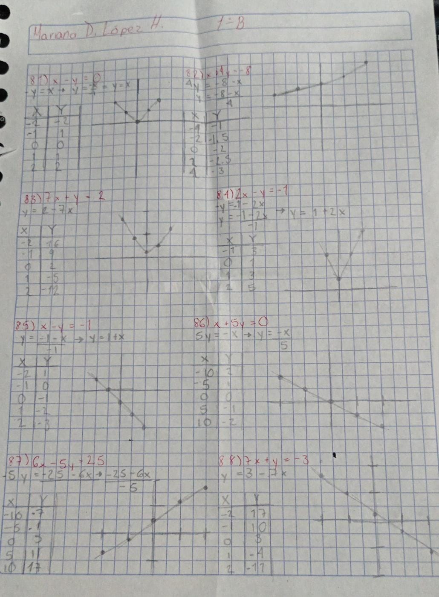

# Fundamentos de Álgebra

## Actividad #23 - Ecuaciones de Primer Grado.

### Alumna: Mariana Donaji López Heredia
---

#### Grafica las siguientes ecuaciones

---

#### Resuelve las siguientes ecuaciones.

89) −30 + 6x = −8(−6 − 4x) \
-30 + 6x = 48 + 32x \
6x - 32x = 48 + 30 \
-26x = 78 \
$x = \frac{78}{-26}$ \
Respuesta: $\textcolor{red}{x = 3}$

90) −3(1 − 6m) = −3 − m \
-3 + 18m = -3 - m \
18m + m =-3 + 3 \
19m = 0 \
$m = \frac{0}{19}$ \
Respuesta: $\textcolor{red}{m = 0}$

91) x − 8(x − 2) = 11 − 8x \
x -8x + 6 = 11 - 8x \
x - 8x + 8x = 11 - 6 \
x= 5 \
Respuesta: $\textcolor{red}{x = 5}$

92) 10 − 8x = 6x + 2(6x − 8) \
10 − 8x = 6x + 12x - 16 \
-8x -6x -12x = -10 - 16 \
-26x = -26 \
$x = \frac{-26}{-26}$ \
Respuesta: $\textcolor{red}{x = 1}$

93) 7 + 3n = −4 + 4(n + 3) \
7 + 3n = -4 + 4n + 12 \
3n - 4n = -4 + 12 - 7 \
-n = 1 \
$n = \frac{1}{-1}$ \
Respuesta: $\textcolor{red}{n = -1}$

**94)** $2 + 5x = 2(8x + 1)$

$$2 + 5x = 16x + 2 \;\Rightarrow\; 5x = 16x \;\Rightarrow\; 11x = 0 \;\Rightarrow\; x = 0$$

**95)** $-1 - 3(1 + 5k) = -26 + 7k$

$$-4 - 15k = -26 + 7k \;\Rightarrow\; 22 = 22k \;\Rightarrow\; k = 1$$

**96)** $-20 + x = 6x - 5(6x - 1)$

$$-20 + x = -24x + 5 \;\Rightarrow\; 25x = 25 \;\Rightarrow\; x = 1$$

**97)** $\dfrac{493}{32} - \dfrac{13}{8}x = -\dfrac{7}{4}\left(-\dfrac{11}{6}x + \dfrac{29}{8}\right)$

$$\frac{493}{32} - \frac{13}{8}x = \frac{77}{24}x - \frac{203}{32}$$

$$\frac{696}{32} = \frac{116}{24}x \;\Rightarrow\; \frac{87}{4} = \frac{29}{6}x \;\Rightarrow\; x = \frac{9}{2}$$

**98)** $\dfrac{5}{3} + x = -\dfrac{7}{6}\left(x - \dfrac{9}{5}\right)$

$$\frac{5}{3} + x = -\frac{7}{6}x + \frac{21}{10} \;\Rightarrow\; \frac{13}{6}x = \frac{13}{30} \;\Rightarrow\; x = \frac{1}{5}$$

**99)** $-\dfrac{96}{35} - \dfrac{4}{3}p = \dfrac{24}{7}\left(\dfrac{14}{3}p - \dfrac{4}{5}\right)$

$$-\frac{96}{35} - \frac{4}{3}p = 16p - \frac{96}{35} \;\Rightarrow\; -\frac{52}{3}p = 0 \;\Rightarrow\; p = 0$$

**100)** $-\dfrac{11}{4}\left(-\dfrac{1}{2}x + 1\right) = -\dfrac{5}{4} + \dfrac{3}{8}x$

$$\frac{11}{8}x - \frac{11}{4} = -\frac{5}{4} + \frac{3}{8}x \;\Rightarrow\; x = \frac{6}{4} = \frac{3}{2}$$

**101)** $-\dfrac{3}{2}r - \dfrac{317}{48} = -\dfrac{19}{8}\left(r + \dfrac{10}{3}\right)$

$$-\frac{3}{2}r - \frac{317}{48} = -\frac{19}{8}r - \frac{95}{12} \;\Rightarrow\; \frac{7}{8}r = -\frac{21}{16} \;\Rightarrow\; r = -\frac{3}{2}$$

**102)** $-\dfrac{7}{6}\left(r + \dfrac{13}{7}\right) = -\dfrac{103}{30} + 2r$

$$-\frac{7}{6}r - \frac{13}{6} = -\frac{103}{30} + 2r \;\Rightarrow\; -\frac{19}{6}r = -\frac{19}{15} \;\Rightarrow\; r = \frac{2}{5}$$

**103)** $\dfrac{13}{7}\left(p + \dfrac{17}{8}\right) = \dfrac{23}{5}p + \dfrac{241}{280}$

$$\frac{13}{7}p + \frac{221}{56} = \frac{23}{5}p + \frac{241}{280} \;\Rightarrow\; -\frac{96}{35}p = -\frac{108}{35} \;\Rightarrow\; p = \frac{9}{8}$$

**104)** $-\dfrac{7}{6}n + \dfrac{7}{75} = -\dfrac{7}{5}\left(\dfrac{1}{2}n - \dfrac{2}{5}\right)$

$$-\frac{7}{6}n + \frac{7}{75} = -\frac{7}{10}n + \frac{14}{25} \;\Rightarrow\; -\frac{7}{15}n = \frac{7}{15} \;\Rightarrow\; n = -1$$

**105)** $\dfrac{1}{12} + \dfrac{1}{8} = \dfrac{5}{24} \;\Rightarrow\; t = \dfrac{24}{5} = 4.8$ horas.

**106)** $\dfrac{1}{13} + \dfrac{1}{E} = \dfrac{1}{4.95} \;\Rightarrow\; E = \dfrac{13 \cdot 4.95}{13 - 4.95} = \dfrac{64.35}{8.05} \approx 8$ horas.

**107)** $\dfrac{1}{15} + \dfrac{1}{N} = \dfrac{1}{5.22} \;\Rightarrow\; N = \dfrac{15 \cdot 5.22}{15 - 5.22} = \dfrac{78.3}{9.78} \approx 8$ horas.

**108)** $\dfrac{1}{10} + \dfrac{1}{15} = \dfrac{1}{6} \;\Rightarrow\; t = 6$ horas.

**109)** $\dfrac{1}{9} + \dfrac{1}{15} = \dfrac{8}{45} \;\Rightarrow\; t = \dfrac{45}{8} = 5.625$ horas.

**110)** $\dfrac{1}{16} + \dfrac{1}{C} = \dfrac{1}{7.74} \;\Rightarrow\; C = \dfrac{16 \cdot 7.74}{16 - 7.74} = \dfrac{123.84}{8.26} \approx 15$ horas.

**111)** $\dfrac{1}{8} + \dfrac{1}{11} = \dfrac{19}{88} \;\Rightarrow\; t = \dfrac{88}{19} \approx 4.63$ horas.

**112)** $\dfrac{1}{10} + \dfrac{1}{J} = \dfrac{1}{5.65} \;\Rightarrow\; J = \dfrac{10 \cdot 5.65}{10 - 5.65} = \dfrac{56.5}{4.35} \approx 13$ horas.

**113)** Shanice recorrió $74 \cdot 3 = 222$ km. Daniel viajó $t$ horas en sentido opuesto:

$$222 + 76t = 298 \;\Rightarrow\; 76t = 76 \;\Rightarrow\; t = 1 \text{ hora}$$

**114)** Distancia de regreso: $12 \cdot 9 = 108$ km. Velocidad de ida:

$$v = \frac{108}{6} = 18 \text{ km/h}$$

**115)** Brenda recorrió $75 \cdot 2 = 150$ km. Shayna viajó $2 + 1 = 3$ horas:

$$v = \frac{150}{3} = 50 \text{ mi/h}$$

**116)** Ida: $t$ horas. Regreso: $t + 1$ horas. Misma distancia:

$$55t = 44(t + 1) \;\Rightarrow\; 11t = 44 \;\Rightarrow\; t = 4 \text{ horas}$$

**117)** Rob salió 1 hora antes, así que viajó 2 horas. Julia viajó 1 hora a $(r - 30)$ km/h:

$$2r + (r - 30) = 180 \;\Rightarrow\; 3r = 210 \;\Rightarrow\; r = 70 \text{ km/h}$$

**118)** $11(455 + v) = 7480 \;\Rightarrow\; 455 + v = 680 \;\Rightarrow\; v = 225$ km/h.

**119)** $(17 + 29)t = 552 \;\Rightarrow\; 46t = 552 \;\Rightarrow\; t = 12$ horas.

**120)** Ida a $v$ durante 6 h. Regreso a $(v + 15)$ durante 4 h:

$$6v = 4(v + 15) \;\Rightarrow\; 2v = 60 \;\Rightarrow\; v = 30 \text{ km/h}$$

**121)** Sea $x$ las libras de metal al 88%:

$$0.88x + 12 = 0.96(x + 12) \;\Rightarrow\; 0.08x = 0.48 \;\Rightarrow\; x = 6 \text{ libras}$$

**122)** Sea $p$ el porcentaje de la primera solución:

$$7p + 5(34) = 12(20) \;\Rightarrow\; 7p = 70 \;\Rightarrow\; p = 10\%$$

**123)** Sea $s$ el contenido de limo del segundo tipo:

$$2(17) + 6s = 8(14) \;\Rightarrow\; 6s = 78 \;\Rightarrow\; s = 13\%$$

**124)** Sea $x$ los galones de solución al 9%:

$$0.09x = 0.05(4 + x) \;\Rightarrow\; 0.04x = 0.2 \;\Rightarrow\; x = 5 \text{ galones}$$

**125)** Sea $c$ el precio por onza de la melaza de caña:

$$4c + 8(1) = 12(2) \;\Rightarrow\; 4c = 16 \;\Rightarrow\; c = \$4 \text{ por onza}$$

**126)** Sea $p$ el porcentaje de la primera solución (3 oz de ácido + 1 oz de agua = 4 oz al 15%):

$$3p = 4(15) \;\Rightarrow\; p = 20\%$$

**127)** Sea $s$ el porcentaje de cacahuates de la segunda marca:

$$18(0.30) + 12s = 30(0.38) \;\Rightarrow\; 12s = 6 \;\Rightarrow\; s = 0.5 = 50\%$$

**128)** Sea $x$ los pies cúbicos de tierra al 41%:

$$0.41x + 0.11(1) = 0.35(x + 1) \;\Rightarrow\; 0.06x = 0.24 \;\Rightarrow\; x = 4 \text{ pies cúbicos}$$
